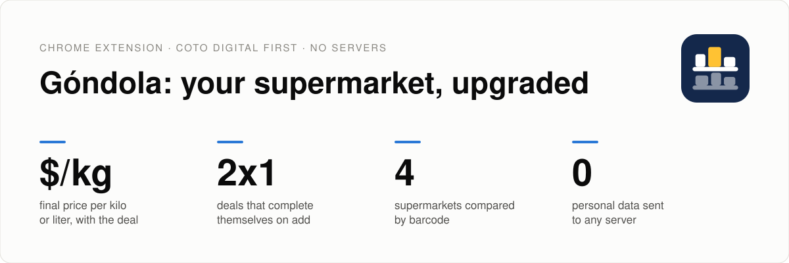
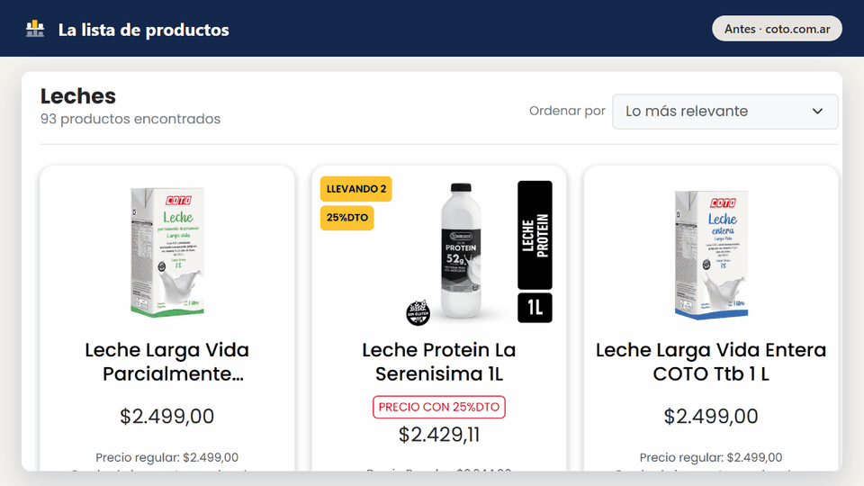
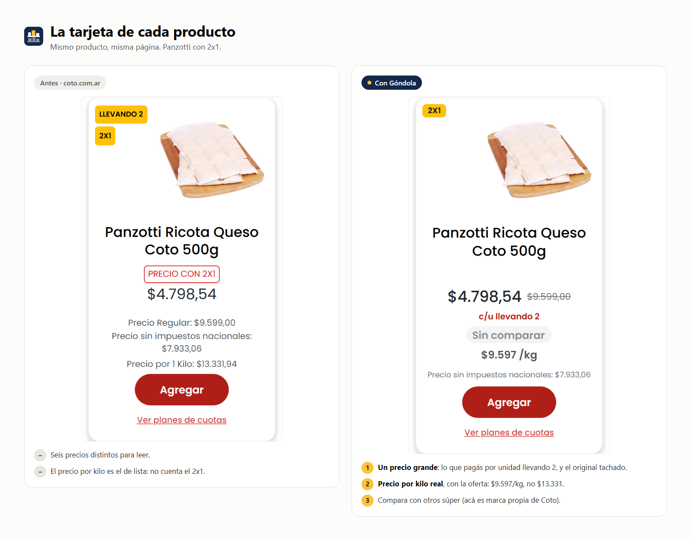
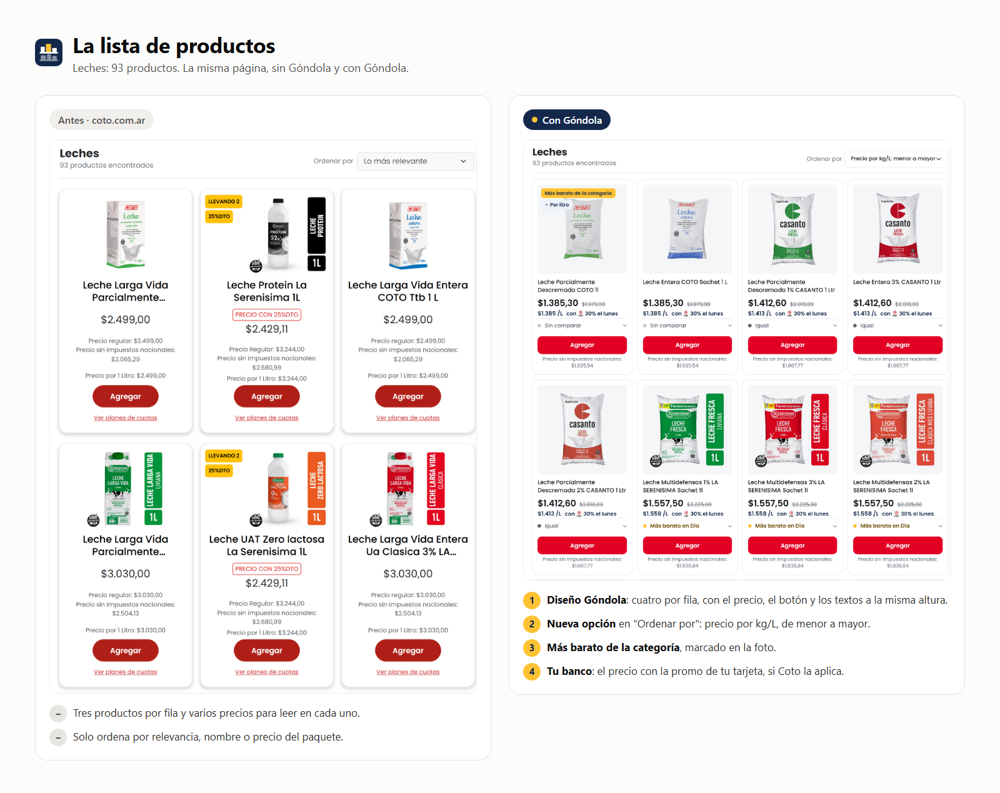
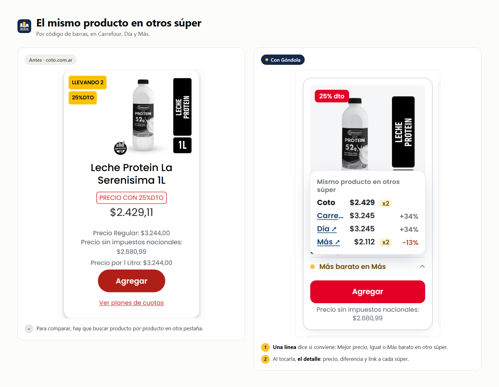
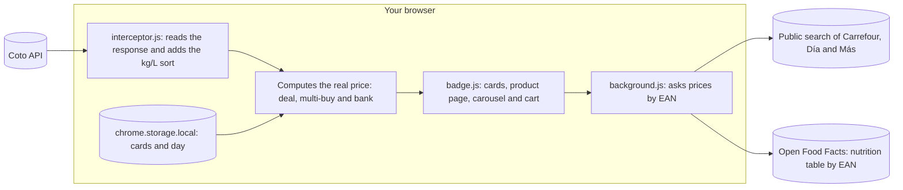

<p align="center">
  <a href="README.md">Español</a> · <b>English</b>
</p>

<picture>
  <source media="(prefers-color-scheme: dark)" srcset="docs/img/en/dark/banner.svg">
  
</picture>

<p align="center">
  <a href="https://hysmarcos.github.io/gondola/"></a>
</p>

<p align="center">
  <a href="https://github.com/hysmarcos/gondola/actions/workflows/ci.yml"></a>
  
  
  
  <a href="https://hysmarcos.github.io/gondola/privacidad.html"></a>
  
  <a href="CONTRIBUTING.md"></a>
</p>

<p align="center">
  
</p>

<p align="center"><sub>Real captures of coto.com.ar. <a href="docs/img/readme/gondola-demo.mp4">Watch the MP4</a>.</sub></p>

Góndola is a Chrome extension that upgrades your supermarket's website. It gives it a clearer design and adds what the site lacks for choosing well: the real price per kilo, your bank, other stores and nutrition facts. It does not break what already works. It starts with [Coto Digital](https://www.coto.com.ar), the online store of a large Argentine supermarket chain. Carrefour, Día, Más and others come next, each as "Góndola for that store". *Góndola* is the Spanish word for a supermarket shelf.

The extension has no servers. Everything runs in your browser.

## In 30 seconds

The question: which of these products is really the best deal, with my card, today?

> [!TIP]
> On Coto, open a category, for example filled pasta. In "Ordenar por" (sort by), pick **Precio por kg/L: menor a mayor**. The product with the lowest price per kilo goes to the top, with the deal, the 2x1 and your bank already applied.

| Fact | Value |
|---|---|
| Stores | Coto Digital. Compares with Carrefour, Día and Más. |
| Browser | Chrome, Manifest V3 |
| Unit price | Kilo, liter, unit or 10 meters (toilet paper and rolls) |
| Personal data sent | None. Settings stay in your browser. |
| Own servers | None |
| Tests | 597, with real responses from the Coto, Carrefour, Día, Más and Open Food Facts APIs |
| Language of the UI | Spanish (Argentina) |

## Before and after

The same Coto page, without and with Góndola. Real captures from November 9, 2026, signed out. The images are in Spanish, like the extension.







## What it adds

| Feature | What it does |
|---|---|
| Dark mode | The whole Coto site in dark, with the logo in black. Pick it in Settings → Appearance (Light, Dark or Automatic, which follows the system). Colors only: it changes and removes nothing from Coto. |
| Góndola design | New look for the product list and the product page. Turn it off in the popup ("Diseño Góndola") to get Coto's own look back. |
| Sort by price per kg/L | Adds "Precio por kg/L: menor a mayor" to the sort menu, in categories and search. |
| Real price on every product | Shows the final price with the best deal, the original price struck through, and the price per kilo, liter or unit. |
| Your bank | Pick your cards and the shopping day in the popup. You see the bank price only if Coto applies the promo to that product. |
| Cheapest in the category | Tags the product with the lowest price per kilo in the whole category. |
| Multi-buy deals | If you add 1 of a 2x1, it adds the second one. On a 3x2 it tells you how many are missing. Can be turned off. |
| Real cart | Subtotal, Coto discounts, bank refund with its cap, and final total. |
| Other stores | Finds the same product by barcode at Carrefour, Día and Más. A button says "Mejor precio" (best price) or "Más barato en Día" (cheaper at Día), with links. |
| Nutrition facts | On a food or drink product page, the nutrition table from [Open Food Facts](https://world.openfoodfacts.org), if it exists. If it is missing, a link to add it. Adds gluten-free status (Coto's data, with a warning if it mentions wheat, oats, barley or rye), allergens, ingredients, additives and NOVA. Can be turned off. |
| My profile | In Settings you choose if you are celiac, watch sodium or sugar, and your allergies. Each product page shows "Para vos" (for you). It stays in your browser. It is not medical advice. |
| Cart nutrition | In the cart, the total kcal, sugars and sodium of your purchase. |
| Allergies in the list | With the Góndola design and nutrition facts on, and coeliac or at least one allergy in your profile, food cards mark the products that declare your allergies, or say there is no allergen data. No tag does not mean safe. |
| Menu and welcome page | Góndola's menu has a fixed size and Settings are split into sections. On install, a welcome page explains how to set it up. When signed in, Coto's profile menu gets a "Configurar Góndola" entry. |

Everything on Coto keeps working: add to cart, quantities, cart and checkout. The extension adds elements and hides some of Coto's parts, with an attribute or with CSS. It never removes any.

## How it works



| Step | Decision | Reason |
|---|---|---|
| Data | Uses the same response Coto sends to the page. To tag the cheapest in a category, it downloads the full category if it has up to 1,000 products. | Prices on the page need no extra requests to Coto. |
| Sort | Reorders the response before it reaches the page | Coto's paging and filters keep working. |
| Real price | Takes the best deal you can pay: list, sale, multi-buy or single-payment discount | It is the number you will actually pay. |
| Size | Uses the format Coto publishes (kg, liter, unit). If it is missing, reads it from the name ("500 GR", "1,5 LT"). | Some products have no format, but the name says the size. |
| Bank | Follows the rules of Coto's promo API and its legal exclusions | If the promo does not apply, it is not shown. |
| Comparison | Searches by barcode, without cookies, with each store's default area | The barcode identifies the same product everywhere. |
| Doubt | If a value does not add up, it shows nothing | No number is better than a wrong number. |

## Can you trust it?

| | Test | Question | Result |
|:---:|---|---|---|
| ✅ | Tests with real data | Are price, size and order right? | 597 tests with saved responses from Coto, Carrefour, Día, Más and Open Food Facts |
| ✅ | Coto keeps working | Do add, quantities and cart behave the same? | Yes. The extension adds elements and hides parts with an attribute (with the Góndola design, also "Ver planes de cuotas" on list cards). With the Góndola design it sets `data-gondola-skin` on `<html>` and hides with CSS the fixed rating stars on the product page. It removes nothing from Coto. |
| ✅ | Bank promos | Does it show a discount Coto does not apply? | No. It follows the days, caps and exclusions of Coto's API. |
| ⚠️ | Other stores | Is it the price at your branch? | Not always. It uses each site's default area and leaves out bank discounts. |
| ⚠️ | Coto changes | Does it keep working if Coto changes its site? | It depends. If the API changes, the extension stops showing data instead of showing wrong data. |

## Privacy and permissions

Góndola collects no personal data, has no analytics and no ads. Full policy (in Spanish): [hysmarcos.github.io/gondola/privacidad.html](https://hysmarcos.github.io/gondola/privacidad.html).

| Permission | What for |
|---|---|
| `storage` | Keep your cards, day and settings in your browser |
| `www.coto.com.ar` | Add the real price, promos and cart on Coto's pages |
| `www.carrefour.com.ar`, `diaonline.supermercadosdia.com.ar`, `www.masonline.com.ar` | Find the same product by barcode. Can be turned off. |
| `world.openfoodfacts.org` | Get the nutrition table of the product you open and of the products in your cart. Only with the Góndola design on and coeliac or an allergy in your profile, also of the food products in the list that scroll into view. Only the barcode is sent, without cookies. Can be turned off. |

## Run it

You need Node 24 and Chrome. Install the dependencies:

```bash
npm install
```

Build the extension into `dist/`:

```bash
npm run build
```

In Chrome, open `chrome://extensions`, turn on **Developer mode**, click **Load unpacked** and pick the repository folder.

Run the tests:

```bash
npm test
```

## Contribute

Góndola is built together. You do not need to code: a clear bug report or a 👍 also changes what gets built.

| If you want to... | Do this |
|---|---|
| Report something broken | [Report a bug](https://github.com/hysmarcos/gondola/issues/new?template=reportar-error.yml) |
| Suggest a feature or a design change | [Suggest an improvement](https://github.com/hysmarcos/gondola/issues/new?template=proponer-mejora.yml) |
| Get Góndola on another store | [Request another store](https://github.com/hysmarcos/gondola/issues/new?template=pedir-super.yml) |
| Decide what comes first | Add a 👍 to the [open ideas](https://github.com/hysmarcos/gondola/issues?q=is%3Aopen+label%3Amejora+sort%3Areactions-%2B1-desc) |
| Write code | Read [CONTRIBUTING.md](CONTRIBUTING.md) and pick a [good first task](https://github.com/hysmarcos/gondola/issues?q=is%3Aopen+label%3Abuena-primera-tarea) |

You can also open the forms from the extension popup, in the **Colaborá** tab. Wrong prices are fixed first, then anything that breaks Coto, then whatever has the most 👍.

Everyone who contributes code, bug reports or ideas that ship is credited in the README's [Gracias](README.md#gracias) section.

## Next steps

1. Publish on the Chrome Web Store.
2. Add more stores as the main site: Góndola for Carrefour, Día and Más.
3. Compare with the branch you pick at each store, not the default area.

## Trademarks and license

Góndola is not affiliated with Coto, Carrefour, Día or Más. Trademarks and logos belong to their owners. The extension uses data those sites already publish.

Nutrition facts come from [Open Food Facts](https://world.openfoodfacts.org), under the [ODbL](https://opendatacommons.org/licenses/odbl/1-0/). Allergen icons are from the UK [Food Standards Agency](https://www.gov.uk/government/publications/download-your-allergen-icons-and-posters), under the [Open Government Licence v3.0](https://www.nationalarchives.gov.uk/doc/open-government-licence/version/3/). Góndola does not use the official Argentine "Sin TACC" symbol: it is only for packaging of approved products.

The code is MIT licensed. The Poppins font uses the [SIL Open Font License](assets/fonts/OFL.txt).
