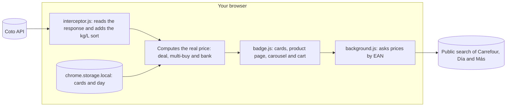

<p align="center">
  <a href="README.md">Español</a> · <b>English</b>
</p>

<picture>
  <source media="(prefers-color-scheme: dark)" srcset="docs/img/en/dark/banner.svg">
  
</picture>

<p align="center">
  <a href="https://hysmarcos.github.io/gondola/"></a>
</p>

<p align="center">
  <a href="https://github.com/hysmarcos/gondola/actions/workflows/ci.yml"></a>
  
  
  
  <a href="https://hysmarcos.github.io/gondola/privacidad.html"></a>
  
</p>

Góndola is a Chrome extension that upgrades your supermarket's website. It adds what the site lacks for buying cheap, without breaking what already works. It starts with [Coto Digital](https://www.coto.com.ar), the online store of a large Argentine supermarket chain. Carrefour, Día, Más and others come next, each as "Góndola for that store". *Góndola* is the Spanish word for a supermarket shelf.

The extension has no servers. Everything runs in your browser.

## In 30 seconds

The question: which of these products is really the best deal, with my card, today?

> [!TIP]
> On Coto, open a category, for example filled pasta. In "Ordenar por" (sort by), pick **Precio por kg/L: menor a mayor**. The product with the lowest price per kilo goes to the top, with the deal, the 2x1 and your bank already applied.

| Fact | Value |
|---|---|
| Stores | Coto Digital. Compares with Carrefour, Día and Más. |
| Browser | Chrome, Manifest V3 |
| Unit price | Kilo, liter, unit or 10 meters (toilet paper and rolls) |
| Personal data sent | None. Settings stay in your browser. |
| Own servers | None |
| Tests | 324, with real responses from the Coto, Carrefour, Día and Más APIs |
| Language of the UI | Spanish (Argentina) |

## What it adds

| Feature | What it does |
|---|---|
| Sort by price per kg/L | Adds "Precio por kg/L: menor a mayor" to the sort menu, in categories and search. |
| Real price on every product | Shows the final price with the best deal, the original price struck through, and the price per kilo, liter or unit. |
| Your bank | Pick your cards and the shopping day in the popup. You see the bank price only if Coto applies the promo to that product. |
| Cheapest in the category | Tags the product with the lowest price per kilo in the whole category. |
| Multi-buy deals | If you add 1 of a 2x1, it adds the second one. On a 3x2 it tells you how many are missing. Can be turned off. |
| Real cart | Subtotal, Coto discounts, bank refund with its cap, and final total. |
| Other stores | Finds the same product by barcode at Carrefour, Día and Más. A button says "Mejor precio" (best price) or "Más barato en Día" (cheaper at Día), with links. |

Everything on Coto keeps working: add to cart, quantities, cart and checkout. The extension only adds elements. It never removes any.

## How it works



| Step | Decision | Reason |
|---|---|---|
| Data | Uses the same response Coto sends to the page. To tag the cheapest in a category, it downloads the full category if it has up to 1,000 products. | Prices on the page need no extra requests to Coto. |
| Sort | Reorders the response before it reaches the page | Coto's paging and filters keep working. |
| Real price | Takes the best deal you can pay: list, sale, multi-buy or single-payment discount | It is the number you will actually pay. |
| Size | Uses the format Coto publishes (kg, liter, unit). If it is missing, reads it from the name ("500 GR", "1,5 LT"). | Some products have no format, but the name says the size. |
| Bank | Follows the rules of Coto's promo API and its legal exclusions | If the promo does not apply, it is not shown. |
| Comparison | Searches by barcode, without cookies, with each store's default area | The barcode identifies the same product everywhere. |
| Doubt | If a value does not add up, it shows nothing | No number is better than a wrong number. |

## Can you trust it?

| | Test | Question | Result |
|:---:|---|---|---|
| ✅ | Tests with real data | Are price, size and order right? | 324 tests with saved responses from Coto, Carrefour, Día and Más |
| ✅ | Coto keeps working | Do add, quantities and cart behave the same? | Yes. The extension adds elements and hides parts with an attribute. It removes nothing from Coto. |
| ✅ | Bank promos | Does it show a discount Coto does not apply? | No. It follows the days, caps and exclusions of Coto's API. |
| ⚠️ | Other stores | Is it the price at your branch? | Not always. It uses each site's default area and leaves out bank discounts. |
| ⚠️ | Coto changes | Does it keep working if Coto changes its site? | It depends. If the API changes, the extension stops showing data instead of showing wrong data. |

## Privacy and permissions

Góndola collects no personal data, has no analytics and no ads. Full policy (in Spanish): [hysmarcos.github.io/gondola/privacidad.html](https://hysmarcos.github.io/gondola/privacidad.html).

| Permission | What for |
|---|---|
| `storage` | Keep your cards, day and settings in your browser |
| `www.coto.com.ar` | Add the real price, promos and cart on Coto's pages |
| `www.carrefour.com.ar`, `diaonline.supermercadosdia.com.ar`, `www.masonline.com.ar` | Find the same product by barcode. Can be turned off. |

## Run it

You need Node 24 and Chrome. Install the dependencies:

```bash
npm install
```

Build the extension into `dist/`:

```bash
npm run build
```

In Chrome, open `chrome://extensions`, turn on **Developer mode**, click **Load unpacked** and pick the repository folder.

Run the tests:

```bash
npm test
```

## Next steps

1. Publish on the Chrome Web Store.
2. Add more stores as the main site: Góndola for Carrefour, Día and Más.
3. Compare with the branch you pick at each store, not the default area.

## Trademarks and license

Góndola is not affiliated with Coto, Carrefour, Día or Más. Trademarks and logos belong to their owners. The extension uses data those sites already publish.

The code is MIT licensed. The Poppins font uses the [SIL Open Font License](assets/fonts/OFL.txt).
