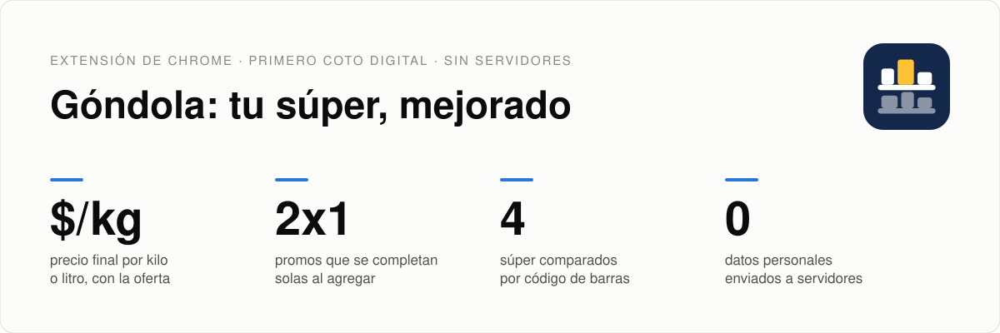
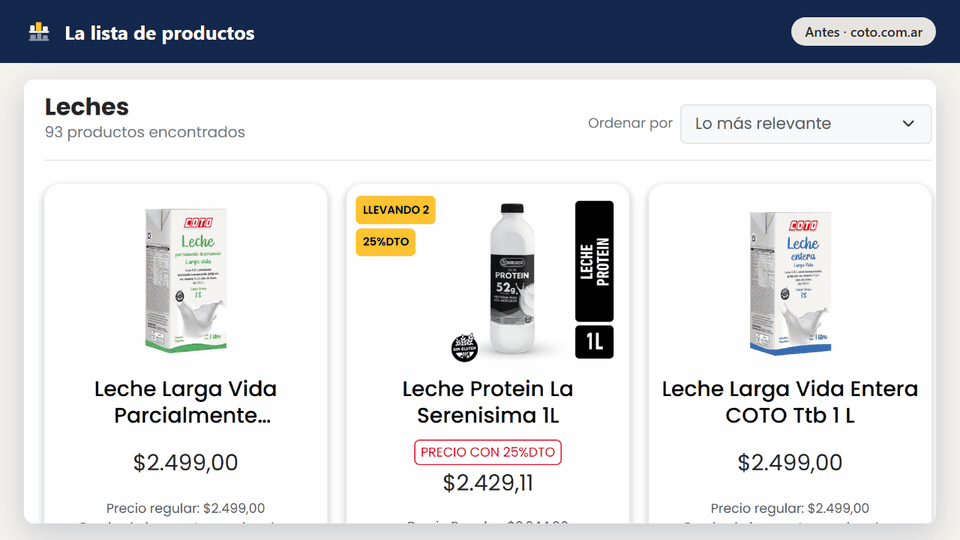
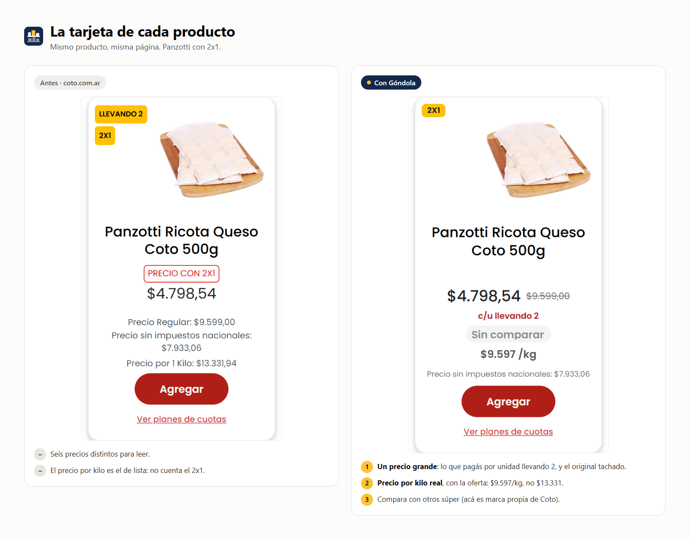
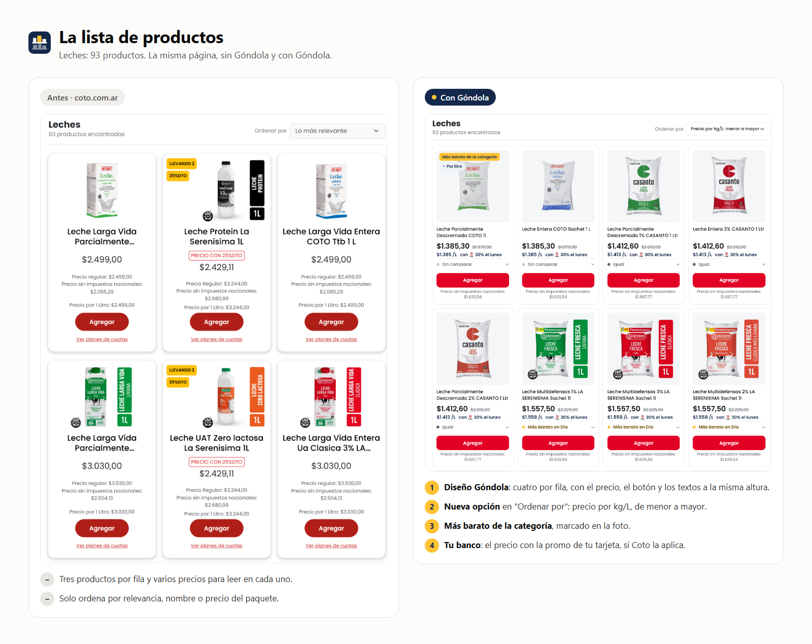
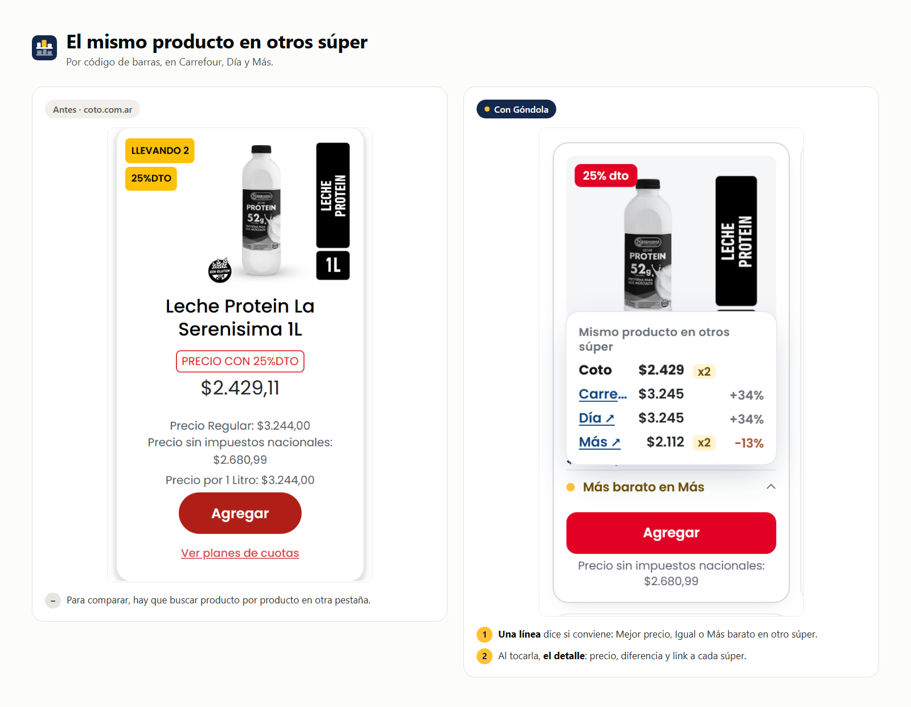
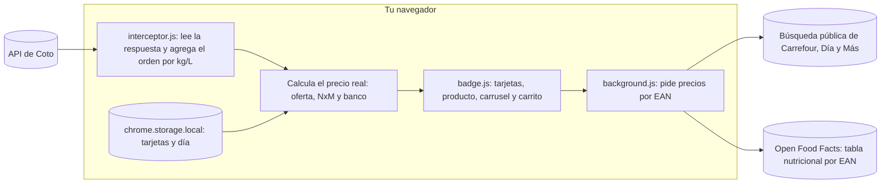

<p align="center">
  <b>Español</b> · <a href="README.en.md">English</a>
</p>

<picture>
  <source media="(prefers-color-scheme: dark)" srcset="docs/img/dark/banner.svg">
  
</picture>

<p align="center">
  <a href="https://hysmarcos.github.io/gondola/"></a>
</p>

<p align="center">
  <a href="https://github.com/hysmarcos/gondola/actions/workflows/ci.yml"></a>
  
  
  
  <a href="https://hysmarcos.github.io/gondola/privacidad.html"></a>
  
  <a href="CONTRIBUTING.md"></a>
</p>

<p align="center">
  
</p>

<p align="center"><sub>Capturas reales de coto.com.ar. <a href="docs/img/readme/gondola-demo.mp4">Ver el video en MP4</a>.</sub></p>

Góndola es una extensión de Chrome que mejora la web de tu supermercado. Agrega lo que le falta para comprar barato, sin romper lo que ya funciona. Empieza por [Coto Digital](https://www.coto.com.ar). Después vienen Carrefour, Día, Más y otros, cada uno como "Góndola para ese súper".

La extensión no tiene servidores. Todo pasa en tu navegador.

## En 30 segundos

La pregunta: ¿cuál de estos productos me conviene de verdad, con mi tarjeta y hoy?

> [!TIP]
> En Coto, abrí una categoría, por ejemplo pastas rellenas. En "Ordenar por", elegí **Precio por kg/L: menor a mayor**. Arriba queda el que más rinde por kilo, ya con la oferta, el 2x1 y tu banco.

| Dato | Valor |
|---|---|
| Súper | Coto Digital. Compara con Carrefour, Día y Más. |
| Navegador | Chrome, con Manifest V3 |
| Precio por unidad | Kilo, litro, unidad o 10 metros (papel higiénico y rollos) |
| Datos personales enviados | Ninguno. Los ajustes quedan en tu navegador. |
| Servidores propios | Ninguno |
| Tests | 461, con respuestas reales de las APIs de Coto, Carrefour, Día, Más y Open Food Facts |

## Qué vas a encontrar

| Si querés... | Leé |
|---|---|
| Ver el antes y el después | [Antes y después](#antes-y-después) |
| Saber qué agrega | [Qué agrega](#2-qué-agrega) |
| Saber cómo calcula el precio | [Cómo funciona](#3-cómo-funciona) |
| Saber cuánto confiar en los números | [¿Se puede confiar?](#4-se-puede-confiar) |
| Saber qué datos usa | [Privacidad y permisos](#5-privacidad-y-permisos) |
| Instalarla o cambiar el código | [Cómo está armado](#6-cómo-está-armado) y [Cómo ejecutar](#7-cómo-ejecutar) |
| Reportar un error, proponer una idea o votar | [Colaborá](#8-colaborá) |
| Entender un término | [Glosario](#glosario) |

## Antes y después

La misma página de Coto, sin Góndola y con Góndola. Son capturas reales del 9 de noviembre de 2026, sin sesión iniciada.

**La tarjeta de cada producto.** Un precio grande con el original tachado, y el precio por kilo real, con la oferta.



**Ordenar por precio por kilo.** Una opción nueva en "Ordenar por" y el más barato de la categoría, marcado.



**El mismo producto en otros súper.** Una palabra dice si conviene. Al pasar el mouse, el precio y el link de cada súper.



> [!NOTE]
> Los precios cambian todos los días. Estas imágenes muestran cómo se ve, no el precio de hoy.

## 1. El problema

La web de Coto sirve para comprar, pero no para comparar:

1. Solo ordena por precio, nombre o recomendados. Un paquete de 500 g y uno de 1 kg no se pueden comparar a simple vista.
2. Las ofertas tienen muchas formas: 2x1, 3x2, descuento en la segunda unidad, descuento por pago en 1 cuota. Cada una cambia el precio real.
3. Las promos bancarias dependen del día, del banco y de exclusiones legales. La web no te dice si se aplican a un producto.
4. El carrito no muestra cuánto te devuelve el banco ni el tope del reintegro.
5. Para saber si otro súper es más barato, hay que buscar producto por producto en otra pestaña.

## 2. Qué agrega

| Función | Qué hace |
|---|---|
| Ordenar por precio por kg/L | Agrega "Precio por kg/L: menor a mayor" al menú "Ordenar por", en categorías y búsquedas. |
| Precio real en cada producto | Muestra el precio final con la mejor oferta y el original tachado, y el precio por kilo, litro o unidad. |
| Tu banco | Elegís tus tarjetas y el día en el popup. Ves el precio con la promo solo si Coto la aplica a ese producto. |
| Más barato de la categoría | Marca con una etiqueta el producto que menos cuesta por kilo en toda la categoría. |
| Promos NxM | Si agregás 1 de un 2x1, agrega el segundo solo. En un 3x2 te avisa cuántos faltan. Se apaga en Ajustes. |
| Carrito real | Subtotal, descuentos de Coto, reintegro del banco con su tope y total final. |
| Otros súper | Busca el mismo producto por código de barras en Carrefour, Día y Más. Un botón dice "Mejor precio" o "Más barato en Día", con los links. |
| Información nutricional | En la página de un producto de comida o bebida, la tabla nutricional de [Open Food Facts](https://world.openfoodfacts.org), si existe. Si falta, un link para cargarla. Suma Sin TACC (dato de Coto, con aviso si menciona trigo, avena, cebada o centeno), alérgenos, ingredientes, aditivos y NOVA. Se apaga en Ajustes. |
| Mi perfil | En Ajustes elegís si sos celíaco/a, si cuidás el sodio o el azúcar, y tus alergias. La página de cada producto te muestra "Para vos". Queda solo en tu navegador. No es consejo médico. |
| Nutrición del carrito | En el carrito, el total de kcal, azúcares y sodio de tu compra. |

Todo lo de Coto sigue funcionando: agregar, cantidades, carrito y pago. La extensión solo agrega elementos. No borra ninguno.

## 3. Cómo funciona

El diagrama muestra el recorrido de los datos en una página de Coto:



Cada paso toma una decisión:

| Paso | Decisión | Motivo |
|---|---|---|
| Datos | Usa la misma respuesta que Coto le manda a la página. Para marcar el más barato de la categoría, baja la categoría completa si tiene hasta 1.000 productos. | Los precios de la página no necesitan pedidos extra a Coto. |
| Orden | Reordena la respuesta antes de que llegue a la página | La paginación y los filtros de Coto siguen andando. |
| Precio real | Toma la mejor oferta que podés pagar: lista, oferta, NxM o pago en 1 cuota | Es el número que de verdad vas a pagar. |
| Tamaño | Usa el formato que publica Coto (kg, litro, unidad). Si falta, lo lee del nombre ("500 GR", "1,5 LT"). | Algunos productos no traen el formato, pero el nombre sí dice el tamaño. |
| Banco | Sigue las reglas de la API de promos de Coto y sus exclusiones legales | Si la promo no aplica, no la muestra. |
| Comparación | Busca por código de barras, sin cookies, con la zona por defecto de cada súper | El código de barras identifica el mismo producto en todos lados. |
| Duda | Si un dato no cierra, no muestra nada | Es mejor no mostrar un número que mostrar uno falso. |

## 4. ¿Se puede confiar?

Estas pruebas buscan dónde falla la extensión:

| | Prueba | Pregunta | Resultado |
|:---:|---|---|---|
| ✅ | Tests con datos reales | ¿El precio, el tamaño y el orden salen bien? | 461 tests con respuestas guardadas de Coto, Carrefour, Día, Más y Open Food Facts |
| ✅ | Coto sigue funcionando | ¿Agregar, cantidades y carrito andan igual? | Sí. La extensión agrega elementos y oculta partes con un atributo. No borra nada de Coto. |
| ✅ | Promos bancarias | ¿Muestra un descuento que Coto no aplica? | No. Respeta los días, los topes y las exclusiones de la API de Coto. |
| ⚠️ | Otros súper | ¿El precio es el de tu sucursal? | No siempre. Usa la zona por defecto de cada web y no incluye descuentos bancarios. |
| ⚠️ | Cambios en Coto | ¿Sigue andando si Coto cambia su web? | Depende del cambio. Si la API cambia, la extensión deja de mostrar datos en vez de mostrar datos falsos. |

## 5. Privacidad y permisos

Góndola no junta datos personales, no tiene analítica y no tiene publicidad. La política completa está en [hysmarcos.github.io/gondola/privacidad.html](https://hysmarcos.github.io/gondola/privacidad.html).

| Permiso | Para qué |
|---|---|
| `storage` | Guardar tus tarjetas, el día y los ajustes en tu navegador |
| `www.coto.com.ar` | Agregar el precio real, las promos y el carrito en las páginas de Coto |
| `www.carrefour.com.ar`, `diaonline.supermercadosdia.com.ar`, `www.masonline.com.ar` | Buscar el mismo producto por código de barras. Se apaga en Ajustes. |
| `world.openfoodfacts.org` | Traer la tabla nutricional del producto que abrís y, con tu perfil cargado, de los productos de la lista que se ven en pantalla. Solo se manda el código de barras, sin cookies. Se apaga en Ajustes. |

## 6. Cómo está armado

| Carpeta o archivo | Contenido |
|---|---|
| `manifest.json` | Configuración de la extensión: permisos, scripts e íconos |
| `src/` | Código: lectura de la API de Coto, precio por unidad, promos, carrito, comparación y popup |
| `assets/` | Ícono, logos de bancos y la fuente Poppins |
| `tests/` | Tests de Vitest y respuestas reales guardadas (`tests/fixtures/`) |
| `scripts/` | Íconos, servidor local, auditoría del catálogo y captura de respuestas |
| `site/` | Sitio de GitHub Pages con la política de privacidad |
| `docs/` | Banner del README, diseños y planes de cada versión |

El build usa esbuild y arma cuatro archivos en `dist/`: `interceptor.js` (corre en la página de Coto), `badge.js` (dibuja la interfaz), `background.js` (pide precios a otros súper y la tabla nutricional) y `popup.js`.

## 7. Cómo ejecutar

Necesitás Node 24 y Chrome. Desde la carpeta del repositorio, instalá las dependencias:

```bash
npm install
```

Armá la extensión en `dist/`:

```bash
npm run build
```

En Chrome, abrí `chrome://extensions`, activá **Modo de desarrollador**, tocá **Cargar descomprimida** y elegí la carpeta del repositorio.

Corré los tests:

```bash
npm test
```

<details>
<summary>Ver los otros comandos</summary>

| Comando | Qué hace |
|---|---|
| `npm run package` | Arma el ZIP para la Chrome Web Store en `release/`. Guía: [docs/chrome-web-store.md](docs/chrome-web-store.md) |
| `npm run icons` | Genera los PNG del ícono desde `assets/icon/icon.svg` |
| `npm run fixtures` | Baja respuestas reales de la API de Coto a `tests/fixtures/` |
| `npm run fixtures:vtex` | Baja respuestas reales de Carrefour, Día y Más a `tests/fixtures/` |
| `npm run fixtures:off` | Baja respuestas reales de Open Food Facts a `tests/fixtures/off.js` |
| `node scripts/capture-readme.mjs` | Captura Coto sin y con Góndola para el README (abre Chrome: no toques la ventana) |
| `node scripts/readme-media.mjs` | Arma las imágenes de antes y después en `docs/img/readme/` |
| `node scripts/dev-server.mjs` | Servidor local en `http://127.0.0.1:8765` para las vistas previas |

</details>

## 8. Colaborá

Góndola la mejoramos entre todos. No hace falta programar: un error bien contado o un 👍 también cambian lo que se hace.

| Si querés... | Hacé esto |
|---|---|
| Avisar que algo anda mal | [Reportar un error](https://github.com/hysmarcos/gondola/issues/new?template=reportar-error.yml) |
| Proponer una función o un cambio de diseño | [Proponer una mejora](https://github.com/hysmarcos/gondola/issues/new?template=proponer-mejora.yml) |
| Tener Góndola en otro súper | [Pedir otro súper](https://github.com/hysmarcos/gondola/issues/new?template=pedir-super.yml) |
| Decidir qué se hace primero | Sumá 👍 a las [ideas abiertas](https://github.com/hysmarcos/gondola/issues?q=is%3Aopen+label%3Amejora+sort%3Areactions-%2B1-desc) |
| Programar | Leé [CONTRIBUTING.md](CONTRIBUTING.md) y elegí una [buena primera tarea](https://github.com/hysmarcos/gondola/issues?q=is%3Aopen+label%3Abuena-primera-tarea) |

También podés abrir los formularios desde la extensión: popup → pestaña **Colaborá**.

Se hace primero lo que da un precio falso, después lo que rompe algo de Coto y después lo que tiene más 👍.

## Gracias

Toda persona que aporta código, reporta un error o propone una idea que se hace aparece acá.

<a href="https://github.com/hysmarcos/gondola/graphs/contributors"></a>

**Ideas y reportes:** todavía no hay. La primera persona puede ser vos.

## Próximos pasos

1. Publicar en la Chrome Web Store. El paquete, los textos y las imágenes están listos: [docs/chrome-web-store.md](docs/chrome-web-store.md).
2. Sumar más súper como sitio principal: Góndola para Carrefour, para Día y para Más.
3. Comparar con la sucursal elegida en cada súper, no con la zona por defecto.

## Glosario

| Término | Qué es | Para leer más |
|---|---|---|
| EAN | Código de barras de un producto, de 8 a 14 dígitos. Es el mismo en todos los súper. | [Wikipedia](https://es.wikipedia.org/wiki/European_Article_Number) |
| Extensión | Programa chico que agrega funciones a Chrome. | [Chrome](https://developer.chrome.com/docs/extensions?hl=es-419) |
| Manifest V3 | Versión actual de las reglas de las extensiones de Chrome. | [Chrome](https://developer.chrome.com/docs/extensions/develop/migrate/what-is-mv3?hl=es-419) |
| NxM | Promo de "llevá N, pagá M", como 2x1 o 3x2. | |
| Precio por unidad | Precio por kilo, litro o unidad. Sirve para comparar paquetes de distinto tamaño. | |
| Open Food Facts | Base abierta de alimentos, armada por la comunidad. Tiene tablas nutricionales por código de barras. | [Open Food Facts](https://world.openfoodfacts.org) |
| VTEX | Plataforma de tiendas online que usan Carrefour, Día y Más. Tiene una búsqueda pública. | [VTEX](https://developers.vtex.com/) |

## Marcas y licencia

Góndola no está afiliada a Coto, Carrefour, Día ni Más. Las marcas y los logos son de sus dueños. La extensión usa los datos que esas webs ya publican.

La información nutricional viene de [Open Food Facts](https://world.openfoodfacts.org), con licencia [ODbL](https://opendatacommons.org/licenses/odbl/1-0/). Los íconos de alérgenos son de la [Food Standards Agency](https://www.gov.uk/government/publications/download-your-allergen-icons-and-posters) del Reino Unido, con licencia [Open Government Licence v3.0](https://www.nationalarchives.gov.uk/doc/open-government-licence/version/3/). Góndola no usa el símbolo oficial "Sin TACC": es solo para envases de productos autorizados.

El código tiene licencia MIT. La fuente Poppins tiene licencia [SIL Open Font License](assets/fonts/OFL.txt).
